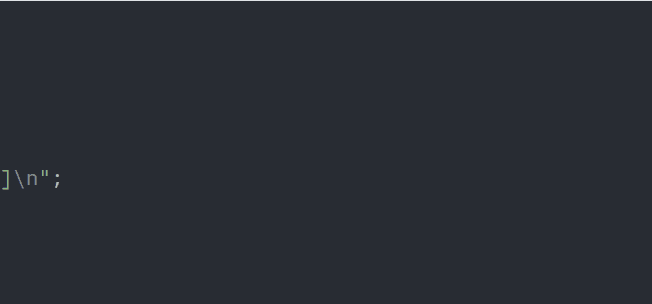

# CHIP-8 Emulator

A CHIP-8 emulator in C++17 and SDL2 that reproduces the original COSMAC VIP’s behavior. It passes the core tests of Timendus’s CHIP-8 test suite, including the quirks test on the original CHIP-8 platform.



## Quick start

Tested on Ubuntu under WSL2.

**Prerequisites**

```
sudo apt install build-essential cmake libsdl2-dev
```

**Build**

```
git clone https://github.com/e-knecht/chip8-emulator.git
cd chip8-emulator
cmake -S . -B build
cmake --build build
```

**Run**

```
./build/chip8 roms/dinorun.ch8
./build/chip8 roms/dinorun.ch8 --cpf 30
```

`--cpf N` sets how many instructions run per frame (default 15, range 1–1000). At 60 frames per second, the default is about 900 instructions per second.

## Controls

The CHIP-8 hex keypad maps to the left side of a QWERTY keyboard:

| CHIP-8 keypad | Keyboard |
|:-------------:|:--------:|
| `1 2 3 C`     | `1 2 3 4` |
| `4 5 6 D`     | `Q W E R` |
| `7 8 9 E`     | `A S D F` |
| `A 0 B F`     | `Z X C V` |

In Dino Run, **W** jumps.

## Test results

Verified with [Timendus's CHIP-8 test suite](https://github.com/Timendus/chip8-test-suite), targeting the original COSMAC VIP CHIP-8.

| ROM | Result |
|-----|--------|
| 1-chip8-logo | <!-- TODO --> |
| 2-ibm-logo   | <!-- TODO --> |
| 3-corax+     | <!-- TODO --> |
| 4-flags      | <!-- TODO --> |
| 5-quirks     | <!-- TODO --> |
| 6-keypad     | <!-- TODO --> |
| 7-beep       | Not supported (no audio yet) |

## Design notes

- **Core and front end are separate.** `chip8.cpp` has no SDL dependency; `main.cpp` handles the window, input and timing.
- **COSMAC VIP quirks.** VF reset after `8xy1/2/3`, `index` incremented by `Fx55/Fx65`, shifts read `Vy`, and `Dxyn` waits for vblank (one sprite per frame).
- **Memory safety.** All memory access wraps at 4 KB, like the original address space.
- **Unsupported instructions.** `0NNN` machine-code calls and SUPER-CHIP opcodes are skipped and reported once each on stderr.

## What I learned

- **Flags and register collisions.** Registers are `uint8_t`, so arithmetic wraps at 256 just like the original hardware. `VF` is also `reg[0xF]`, so an instruction like `8FY4` would have its result overwritten by the flag. Every flag-setting instruction computes from the original values first and writes `VF` last.
- **Masking isn't extracting.** My first `6XNN` wrote to `reg[opcode & 0x0F00]`, which is index 256 in a 16-entry array. Pulling out a field takes a mask *and* a shift.
- **Off-by-one errors.** `% 0xF` instead of `% 16` made key `F` unreachable, and `% 0xFFF` instead of `& 0xFFF` wrapped memory one byte early. A mask and a size are different numbers.
- **Test ROMs as a roadmap.** Timendus's suite showed me which opcode group to build next. Reporting unknown opcodes made missing instructions obvious; I later limited it to once per opcode on stderr so a ROM stuck executing garbage doesn't flood the terminal.
- **CHIP-8 has no single spec.** The quirks test failed four rows because I'd implemented modern behavior. Following the test suite's documentation, I switched to the original COSMAC VIP's behavior (VF reset, index increment, shifting from `Vy`, and display wait) and reran the test after each fix until all six passed.

## Future work

- Sound (the sound timer runs, but no tone plays)
- Steadier 60 Hz timing
- Configurable quirks for SUPER-CHIP-era ROMs

## License

MIT for the emulator code. The bundled ROMs have their own licenses; see [roms/README.md](roms/README.md).
